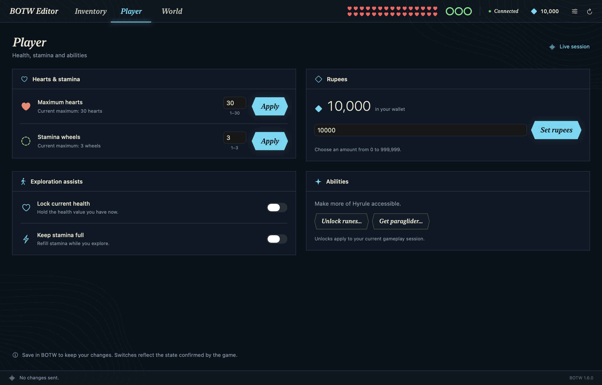
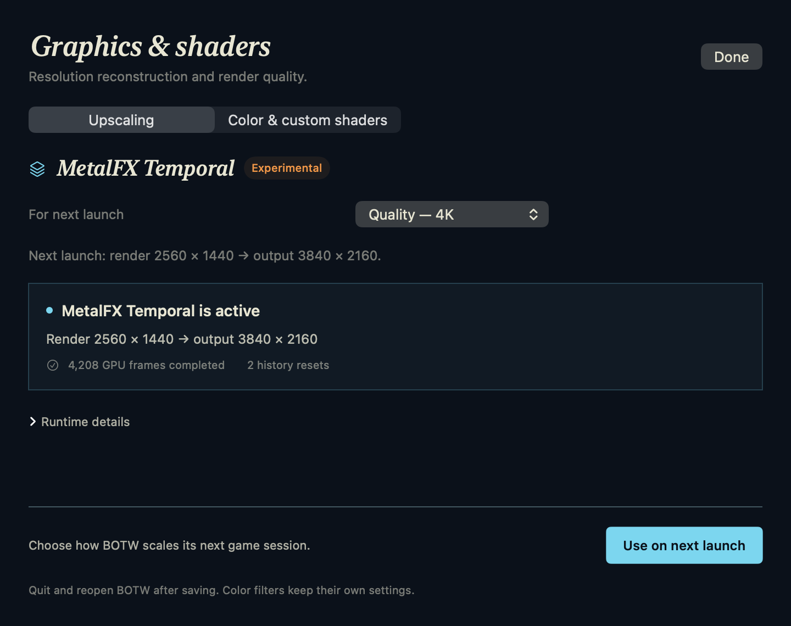

# BOTW Editor

A native Mac editor for your running **Breath of the Wild 1.6.0** session in [MacNativeGames](https://github.com/ly05010419/MacNativeGames).

Browse your pouch, give items, change player stats, and travel around Hyrule from a separate window. The Sheikah-inspired interface uses compact navigation, an item grid with a persistent inspector, and travel controls over the actual local map.

**BOTW Editor targets one game/runtime version.** See the [live testing record](docs/TESTING.md) for verified operations and remaining checks.

[Download BOTW Editor](https://github.com/christianfurr/botw-editor/releases/tag/v0.1.5) · [Setup](docs/INSTALLATION.md)

**MacNative Mods** is a separate app for Switch RomFS mods. It supports compatible MacNativeGames builds of Breath of the Wild, Tears of the Kingdom, and Octopath Traveler 0. [Download MacNative Mods](https://github.com/christianfurr/botw-editor/releases/tag/mods-v0.1.0) [Mods guide](docs/MODS.md)



## What you can edit

| Area | Controls |
| --- | --- |
| Inventory | Browse a pouch grid and search a 1,012-item catalog. Add items, change stack quantities or unequipped weapon durability, and remove entries. |
| Master Sword | Select the usable sword in your pouch and apply awakening levels with 30, 40, 50 or 60 normal attack. The sword must be owned and unequipped. |
| Pouch slots | Increase weapon, bow and shield capacity up to 20, 14 and 20 slots respectively. Capacity edits do not give items or spend Korok seeds. |
| Player | Rupees, maximum hearts, maximum stamina, and optional current-health/stamina locks. |
| World | Enable the in-game Sheikah Slate map; discover and activate a selected shrine or all 120 base-game shrine travel points; reveal the 15 tower map regions; acquire base runes and the paraglider. Activation does not clear a shrine. |
| Shrine completion | Separately mark a selected shrine or all 120 base shrines cleared. The clear count increases only for newly cleared shrines. This grants no Spirit Orbs, quests, chests or other rewards. |
| Full Access | Activate base-shrine travel, reveal tower regions, acquire base runes and the paraglider, and raise the world towers. **This skips the opening tower activation sequence.** It does not directly mark shrines or story quests complete. |
| Map | Browse the game's Hyrule terrain with 557 locally extracted place labels, search 120 base shrines and 15 towers, and select a destination for travel. Labels appear by zoom level; a live marker shows your position. |
| Horse speed | Apply 1.00–2.00× normal land-gear speeds to all 26 standard horse types for this session. Off restores original speeds. Special mounts and unrelated animals are unchanged. |
| Upscaling | Experimental MetalFX Temporal reconstruction with Quality/Balanced presets for 1440p or 4K output. Preset changes require restarting BOTW. |
| Color & custom shaders | Use Off, Natural, Vivid, or Cinematic picture filters, adjust strength and sharpness, or write a custom Metal color shader. |

The installer builds the terrain map, place labels and item icons **locally from your own game**. They stay in your private Application Support cache and are not included in this repository or the editor download. [Local artwork and map extraction](docs/MAP-EXTRACTION.md)

The catalog distinguishes the usable Master Sword from its internal world/appearance forms. Choosing an internal form offers a way to select the usable sword; trying to give a duplicate explains the game's one-sword limit. The pouch and catalog share an icon-grid layout, keep quantity and **Give item** visible, and display the actual inventory blocker when one exists. Browsing remains available while the game is closed.

Live trainer controls wait for a supported gameplay session and fresh runtime state. The editor displays the game's acknowledgement and readback for each request. During travel, it disables those edits while the game loads. Check arrival in the game.

Earlier live checks covered core inventory/player/world edits, menu-open grants, custom-shader fallback, and real MetalFX temporal frames at 1440p and 4K. The 0.1.3 checks opened the map and rune selector, read back all four sword levels, granted equipment beyond the original pouch limits, and confirmed 120 saved shrine clears. The [testing record](docs/TESTING.md) tracks these results and the remaining mounted movement and mod checks.

## MetalFX Temporal



Open the sliders button, choose **Upscaling**, select a preset, then click **Use on next launch**. Quit and reopen BOTW. The panel reports the actual render/output dimensions and completed GPU work; saving a setting alone does not mean it is active.

Quality at 4K renders at **2560 × 1440** and reconstructs **3840 × 2160**. Quality at 1440p renders at **1920 × 1080** and reconstructs **2560 × 1440**. Balanced presets use a lower input resolution. Off retains the port's original scaling.

This integration currently estimates camera motion and uses a depth-reactive mask. Moving objects and newly revealed regions can show artifacts. It is experimental: no DLSS-equivalent quality or measured frame-rate gain is claimed. Color filters remain a separate setting. [Presets, status and limitations](docs/TEMPORAL.md)

## Requirements

- Apple silicon Mac running **macOS 26 or later**.
- An existing, working MacNativeGames **BOTW 1.6.0** app built from your own game files.
- MacNativeGames checkout at supported commit [`b1a49a2`](https://github.com/ly05010419/MacNativeGames/tree/b1a49a26650eb31a986e7841f449bb44446c5208), with its build environment and work folder available.
- The BOTW Editor runtime bridge installed into that app.

BOTW 1.9.0, Tears of the Kingdom, physical Switch consoles, and standard Switch cheat files are outside this release's compatibility target.

## Install

1. Download **BOTW.Editor.zip** and **Source code (zip)** from the same repository release. Unzip both and move **BOTW Editor.app** to Applications. Open a terminal in the unpacked source folder for the bridge installer.
2. Quit BOTW, then install the bridge from this repository:

   ```sh
   python3 scripts/install-bridge.py \
     --repo "/path/to/MacNativeGames" \
     --app "/Applications/Breath of the Wild.app" \
     --work "/path/to/BotW_build"
   ```

3. Keep the backup paths printed by the installer. It checks compatibility, preserves restore copies, rebuilds the runtime, and extracts your local destinations, terrain map, place labels and item icons.
4. Open BOTW and load your game. Open **BOTW Editor** and wait for its connected state.

The editor release contains no game files, firmware, keys, or saves. The bridge uses the local files already present in your MacNativeGames installation.

The current app is **ad hoc signed and not Apple-notarized**. If macOS blocks the downloaded app after you try to open it, use **System Settings → Privacy & Security → Open Anyway** for BOTW Editor and confirm the app name. You can also build it locally from source. [Apple's opening instructions](https://support.apple.com/en-us/102445)

## Use

- **Inventory:** select a tile to inspect it. Apply a new stack quantity or durability value in the detail pane, or choose **Remove Item…**. Unequip gear before editing its durability or removing it. Use **Give item…** to browse the catalog, choose a quantity, and select **Give item**. A successful grant stays visible in the result bar. If Link is holding cooking materials, put them away before editing inventory.
- **Outfits.** Open **Inventory → Give item… → Armor → Give all outfits…** to add one copy of each missing base armor piece. An upgraded piece counts as owned. The editor reports how many pieces BOTW accepted, and you can stop after the current request.
- **Master Sword:** select the usable Master Sword (`Weapon_Sword_070`) in Inventory. Unequip it in BOTW, choose an **Awakening level**, then click **Apply level**. The four levels configure 30/40/50/60 normal attack. Nearby evil can still awaken the sword to 60. This control does not change beam power, durability, recharge or Trial of the Sword quest completion.
- **Pouch slots:** open **Pouch slots…** from the Inventory footer. Choose a larger capacity and click that row's **Apply** button. Supported ranges are weapons 8–20, bows 5–14 and shields 4–20. Capacity can only increase; Korok counts and Hestu quests stay unchanged. Reopen the game's pouch if its displayed capacity is cached.
- **Player:** use the stat buttons to apply values. Maximum hearts and stamina wait for the live player values to load. The health lock holds your current health; the stamina lock refills stamina. Both locks start off.
- **World:** **Enable in-game map** enables Sheikah Slate access separately from revealing terrain. Focus BOTW and press **Tab** or **M** afterward. The editor's terrain map remains available for selecting travel destinations. Read the confirmation before applying **Full access**, which also skips the opening tower activation sequence.
- **Runes:** choose **Unlock runes** to acquire the base kit and enable Slate access. If no rune is selected, the bridge requests a Bomb selection through the same manager field used by the game's download sequence. The normal game update still has to apply that request; a busy selection step asks you to retry. With BOTW focused during ordinary unmounted gameplay, hold **3** to choose a rune, release it, then press **F** to use it. These are the port's default keyboard bindings.
- **Shrines:** activation discovers a shrine on the in-game map and enables its travel point. Reopen the map after applying it. The separate **Mark cleared** or **Mark all cleared** actions change clear state and its counter; they do not grant rewards or finish quests.
- **Horse speed:** use the Player panel's speed control and **Apply**. The multiplier affects the four normal land gears of every standard horse type in this running session. **Off** restores the verified original table. It resets when BOTW restarts and does not change saved horse stats.
- **Upscaling:** open the sliders button and choose **Upscaling**. Save a preset with **Use on next launch**, then fully quit and reopen BOTW. The saved preset and the current session's active status are displayed separately.
- **Color & custom shaders:** choose this section of the same panel to adjust the final picture. Its **Off** restores unfiltered color without changing the upscaling preset. Custom source and fallback behavior are documented in [Shaders](docs/SHADERS.md).
- **Tower travel:** activate the first tower in BOTW or use **Full Access** before traveling to a tower that the editor marks unavailable.
- Read each action result before making another edit. Live trainer edits require a supported game session and fresh connection data.

The new 0.1.3 controls require the updated runtime bridge. Older runtime snapshots remain readable; unsupported controls show **Runtime update required** until the bridge is installed and BOTW is relaunched.

Changes can become permanent when the game saves. Keep a profile backup before changing inventory or progress. See [Installation and recovery](docs/INSTALLATION.md).

## Build from source

Use an Apple silicon Mac on macOS 26 or later, with Xcode command-line tools that provide a macOS 26 or newer SDK. Run:

```sh
./scripts/build.sh
```

The build runs the Swift model/UI/graphics checks, native runtime and temporal-input guards, real MetalFX probes, synthetic color-filter pixel checks, and installer fixtures. It produces `build/BOTW Editor.app`, `build/BOTW Editor.zip`, and a SHA-256 checksum alongside the ZIP. The app includes the item-name catalog, original interface artwork, native icon, and license notices. Building the editor needs no game files.

To run the checks without packaging the app:

```sh
./scripts/test.sh
```

The macOS 26 CI job runs the same editor build without installing the bridge or launching a game. A runner without a Metal device reports a GPU-test skip; that skip does not prove GPU results. Builds use ad-hoc code signing; they are not notarized or signed with a Developer ID certificate.

Runtime bridge installation is a separate step. Rebuilding the editor alone does not update the game app.

## Project notes

- [Architecture](docs/ARCHITECTURE.md)
- [Testing and release evidence](docs/TESTING.md)
- [Installation and recovery](docs/INSTALLATION.md)
- [Switch RomFS mods and BCML exports](docs/MODS.md)
- [Private terrain map and item artwork](docs/MAP-EXTRACTION.md)
- [MetalFX Temporal reconstruction](docs/TEMPORAL.md)
- [Color filters and custom Metal shaders](docs/SHADERS.md)
- [Third-party notices](THIRD_PARTY_NOTICES.md)

MIT licensed. This independent project is not affiliated with Nintendo. The Legend of Zelda and Nintendo Switch are trademarks of Nintendo.
